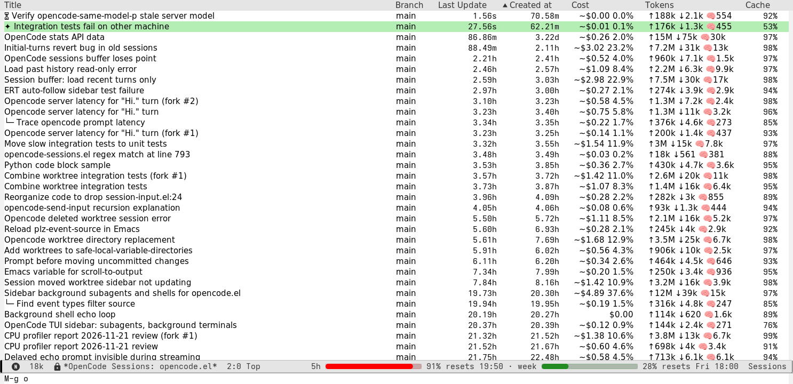
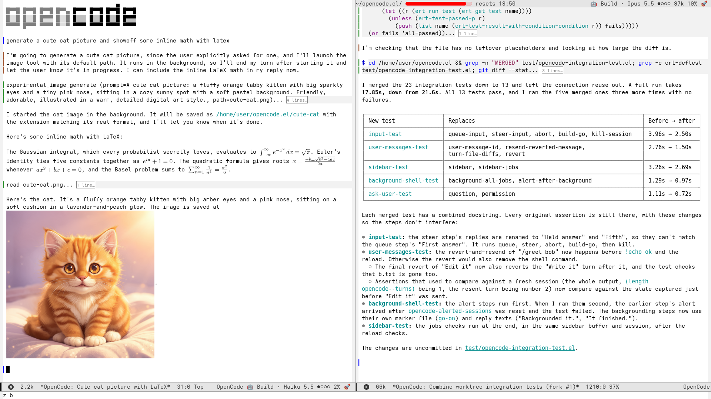

#+TITLE: Emacs OpenCode UI
#+OPTIONS: toc:nil

An emacs UI to [[https://opencode.ai/][opencode]] - an open source AI coding agent. This provides two sets
of advantages over the official TUI:

1) A better TUI and GUI

   #+begin_verse
   Emacs is a mature TUI and GUI framework, that while janky in its own way, is
   far less janky than the TUIs the new agentic coding tools have written from
   scratch. This package builds on a solid foundation of [[https://www.emacswiki.org/emacs/ComintMode][comint]], [[https://www.gnu.org/software/emacs/manual/html_mono/vtable.html][vtable]],
   [[https://www.gnu.org/software/emacs/manual/html_node/emacs/Diff-Mode.html][diff-mode]], [[https://www.gnu.org/software/emacs/manual/html_node/emacs/Hideshow.html][hideshow]], =markdown-ts-mode=, emacs' completion system, and more, to
   offer a (IMO) nicer UI. Also if you're an emacs user, the UI is more
   consistent: goto next or previous prompt, history search, and everything else
   works the same as in any other repl or shell based on comint mode, completion
   and filtering works the same as everywhere else in emacs, and everything is
   just a text buffer where all your usual editing and other commands work as
   expected.
   #+end_verse

2) Emacs integration

   - runs =opencode-file-edited-functions= after edit tool calls. The default
     hook will reload file after edits to emacs lisp files. You can also add
     =opencode-fix-parens= to fix parentheses with parinfer if =parinfer-rust-mode=
     is installed after edits to lisp files.
   - calls =opencode-files-finished-editing-functions= with a list of all files
     changed in the last assistant turn, including by shell commands, according
     to the server's snapshot diff, so it requires a git repository and gitignored
     files aren't included. Add =opencode-indent-files= here to
     automatically fix indentation with =indent-region=, and
     =opencode-flycheck-edited-files= to run flycheck and report all errors and
     warnings in the edited files to the LLM.

     #+begin_quote
     *⚠️ WARNING:* opencode-fix-parens, opencode-indent-files, and
     opencode-flycheck-edited-files are all disabled by default, but if you use
     them they call revert-buffer, discarding changes in emacs in favor of llm
     edits. I use git worktrees or just stash, if I am editing at the same time
     as an llm.
     #+end_quote

     You can set project specific hooks in
     =opencode-project-files-finished-editing-functions=. We include
     =opencode-uv-pytest= and =opencode-emacs-ert= which will run all tests from
     pytest and ERT and report errors to the LLM. They are defined using
     =opencode-run-command-diagnostic= which you can use to run any shell command
     and report errors to the LLM. To set up a python project to run pytest
     after LLM edits add your project directory to
     =safe-local-variable-directories= and then create a =.dir-locals.el= in the
     project directory with:
     #+begin_src elisp
((nil . ((opencode-project-files-finished-editing-functions . (opencode-uv-pytest)))))
     #+end_src
   - add any emacs buffer to chat context with =opencode-add-buffer-dwim=
   - add files from dired to context with =opencode-add-file-dwim=
   - add selected region to context with =opencode-add-region=
   - add function at point to context with =opencode-add-defun=
   - start a new session to fix all flycheck errors in the current buffer with
     =opencode-fix-flycheck=, or with a prefix argument it will just fix the
     flycheck errors at point
   - start a new session to diagnose and fix failed tests from the ERT results
     buffer with =opencode-fix-ert=, bound to =o= in =ert-results-mode=. By default it
     will diagnose all failed tests, but with a prefix argument will just
     diagnose the test at point.
   - integration with magit is possible, =opencode-new-worktree= will create a new
     git branch and worktree for the current project, and start an opencode session in it
   - =`file`= and =file:line= references in LLM output are turned into clickable buttons
   - use =dabbrev-expand= in the chat window to complete long variable or function
     names from your code buffers. We set =dabbrev-select-buffers-function= in the
     chat windows, to include all other buffers from your project.
   - configure how your custom MCP and tools are displayed with =opencode-tool-formatters=
   - I use with [[https://codeberg.org/sczi/eval-elisp-mcp][eval-elisp-mcp]] when developing in elisp.
   - For python development integrated with opencode.el, with features like AI
     autodebugging exceptions, check out [[https://codeberg.org/sczi/swanky-python/][Swanky Python]]

* Demo
A brief demo showing starting opencode, viewing a past session, sharing it,
toggling an MCP, selecting the agent, model, and variant, performing some edits,
receiving a notification when the response is finished if the session buffer
isn't focused, reverting edits, and forking the session.
#+HTML: <video src="/sczi/opencode.el/media/branch/main/screenshots/demo.webm" controls></video>

* Installation
When this package is a bit more stable I'll package it on MELPA, for now install
from git. This package requires Emacs 31.1 with the =markdown= and =markdown-inline=
Tree-sitter grammars (install with =M-x markdown-ts-mode-install-parsers=), plus
[[https://github.com/magit/magit][magit]], [[https://github.com/alphapapa/plz.el][plz]], [[https://github.com/r0man/plz-media-type][plz-media-type]], and [[https://github.com/r0man/plz-event-source/][plz-event-source]]. With the following
instructions dependencies will automatically be installed, except for the tree
sitter grammars, which you will be prompted to install when they are first
needed.
** Emacs use-package
#+begin_src emacs-lisp
(use-package opencode 
  :vc (:url "https://codeberg.org/sczi/opencode.el.git" :rev :newest))
#+end_src
** In Doom Emacs
add to =packages.el= and run =doom sync=
#+begin_src emacs-lisp
(package! opencode
  :recipe (:host codeberg :repo "sczi/opencode.el"))
#+end_src

* Connecting
** Automatic
=M-x opencode= will try to connect to an opencode server at
=opencode-host:opencode-port= or will start a headless opencode server if one
isn't already running. Then it opens a [[#6679896c-5b9d-4e87-9e03-6ed060dec278][Session Management]] buffer for the current
project.
** Manual
=M-x opencode-connect= will prompt for the host and port of an opencode server to
connect to.

* Project Management
In opencode, sessions are grouped by project, where each git repository is a
different project. Different git worktrees for the same repository will be
grouped in the same project. Sessions started in directories outside of any git
repository will go in the global =/= project. =opencode-select-project= will fuzzy
complete on all projects and open the [[#6679896c-5b9d-4e87-9e03-6ed060dec278][Session Management]] buffer for the project
you select. When creating a new git repository or adding a git remote, you need
to run =opencode-reload-locations= for the OpenCode server to pick up the changed
project.

* Session Management
:PROPERTIES:
:CUSTOM_ID: 6679896c-5b9d-4e87-9e03-6ed060dec278
:END:

Here you see a table view with information on all sessions for a given project.
You can configure what columns are shown with =opencode-session-control-table-columns=.

With a claude subscription plan, the cost column will show an estimate in
dollars at API pricing, and show the estimated percent of the 5 hour limit a
session has used.

The mode line shows the actual usage of your 5 hour and weekly limits, as last
reported by Claude Code. Until a claude-agent session makes a request, it is
read from the most recent one, so can under report if you use claude outside of
opencode.

PRs are welcome to add this information for providers of other subscription
plans you may have.

Shortcuts to act on the session at point:

|   Key    | Description       |
|----------+-------------------|
|   <c>    |                   |
|    =x=     | kill session      |
|    a     | archive session   |
|    u     | unarchive session |
|    =R=     | rename session    |
| =RET= or =o= | open the session  |

When a region is selected, =x=, =a=, and =u= will operate on every selected session.

Buffer-wide shortcuts:

| Key | Description                                                                      |
|-----+----------------------------------------------------------------------------------|
| <c> |                                                                                  |
|  =n=  | new session                                                                      |
|  =M=  | toggle MCP - fuzzy completes on all available MCPs                               |
|  =v=  | toggle verbose - whether to show subagent sessions, as a tree under their parent |
|  A  | toggle display of archived sessions                                              |

When a session is busy, you will see a busy indicator (⏳) by its row in the
table. When a session has raised a notification (response finished, form, or
permission prompt), you'll see a "✦" by its row until you've visited the
session. These are the same sessions you can visit with =opencode-select-idle=. If
the session had an error, you'll see a ❌ instead of ✦. A 🗄 will be shown for
archived sessions, which are not displayed by default (toggle their display with =A=).

* Chat Sessions

[[file:screenshots/session_with_diff.png]]

This is what session buffers look like. In the modeline at the bottom right we
see the current agent, current model, model variant if one is selected (like
low/medium/high thinking level), the percent of context used up so far, and an
indicator for if the session is idle or busy. User prompts are shown with a blue
margin highlight, information about tool calls in green, and reasoning in brown.
These colors can be configured through the =opencode-*-margin-highlight= faces.

Reasoning, tool output, and the diffs of edits are folded with =hs-minor-mode=,
leaving their first line visible. Click the ellipsis or use =hs-toggle-hiding=
(=C-c @ C-c=) on the first line to expand them, and =hs-show-all= (=C-c @ C-M-s=)
to expand everything.

Imenu contains all user messages for the session, so you can use =consult-imenu=
to quickly search through and jump to past messages.

Images are displayed inline, and if you have =latex= and =dvisvgm= then math
formulas will also be rendered. To install in arch linux run:
#+begin_src sh
pacman -Sy texlive-latex texlive-latexrecommended texlive-fontsrecommended dvisvgm
#+end_src

|   Key   | Description                                                                                                                                                                                                                |
|---------+----------------------------------------------------------------------------------------------------------------------------------------------------------------------------------------------------------------------------|
|   <c>   |                                                                                                                                                                                                                            |
| =C-c C-y= | yank code block at point                                                                                                                                                                                                   |
|  =C-c y=  | yank-media, adds an image from clipboard to context                                                                                                                                                                        |
|  =C-c Y=  | Copy the full conversation as a Markdown transcript, including reasoning and tool outputs. @@html: @@ Useful to gather context in OpenCode, and then iterate on a plan in webchat if webchat has separate usage limits. |
| =C-c C-c= | cancel the current request, with a prefix argument also cancels background subagents                                                                                                                                       |
| =C-c C-p= | respond to a permission request or question                                                                                                                                                                                |
|  =C-c x=  | delete this session                                                                                                                                                                                                        |
|   =TAB=   | cycle through available primary agents                                                                                                                                                                                     |
|  =C-c R=  | rename this session                                                                                                                                                                                                        |
|  =C-c n=  | start a new session in the same project                                                                                                                                                                                    |
|  =C-c l=  | list and select from all sessions in the same project                                                                                                                                                                      |
|  =C-c c=  | fuzzy select a child session to open - children are all subagent  sessions spawned by this session                                                                                                                         |
|  =C-c C=  | compact session                                                                                                                                                                                                            |
|  =C-c t=  | scroll to the top of the text part of the last assistant response                                                                                                                                                          |
|  =C-c p=  | open parent session - when in a subagent session, open the session that spawned it                                                                                                                                         |
|  =C-c f=  | select a file to add to context, if called with a prefix argument then select a directory                                                                                                                                  |
|  =C-c b=  | /btw — ask a side question about the conversation without adding to it, the answer opens in a new buffer                                                                                                                   |
|  =C-c B=  | select a buffer to add to context                                                                                                                                                                                          |
|  =C-c m=  | select model                                                                                                                                                                                                               |
|  =M-TAB=  | cycle to the next reasoning level                                                                                                                                                                                          |
| =M-S-TAB= | cycle to the previous reasoning level                                                                                                                                                                                      |
|  =C-c M=  | select an MCP to toggle                                                                                                                                                                                                    |
|  =C-c F=  | fork session from message at point                                                                                                                                                                                         |
|  =C-c r=  | revert all edits done by this session after the message at point                                                                                                                                                           |
|  =C-c e=  | ediff changes during the turn of the message at point                                                                                                                                                                    |
|    =/=    | when at the start of a user prompt, select a slash command to run                                                                                                                                                          |
|    =@=    | reference a sub-agent                                                                                                                                                                                                      |

* Notifications
If a session buffer and frame is not active, emacs will show a notification when
that session's response has finished, so that you can go work on other stuff and
be notified when the agent has finished. You can visit the session that last
raised a notification with =opencode-visit-last-idle=, or prompt for all sessions
that haven't been visited since their last notification with =opencode-select-idle=.

* Usage statistics
=opencode-stats= shows statistics on model, project, and tool usage, along with a
heatmap of activity and a graph of token usage over time. You can click on a bar
in the graph or a square in the heatmap to go to that time period. When the time
period is one day, it will also show a table with information about sessions
active during that day, and clicking on a session will open it. A header at the
top shows the keybindings you can use to change the time period or information shown.

* Commands
#+begin_src emacs-lisp :results table :colnames '("Command" "Description") :exports results
(cl-loop for command in '(opencode opencode-connect opencode-disconnect
                          opencode-select-project opencode-select-session opencode-select-open-session
                          opencode-new-worktree opencode-new-session
                          opencode-select-idle opencode-visit-last-idle
                          opencode-add-file-dwim opencode-add-region opencode-add-defun
                          opencode-add-buffer-dwim opencode-fix-flycheck opencode-reload-locations
                          opencode-unrevert-all opencode-fix-ert opencode-list-connections
                          opencode-consult-sessions opencode-stats)
         collect (list command
                       (string-join (string-lines (documentation command)) " ")))
#+end_src

#+RESULTS:
| Command                      | Description                                                                                                                                                                                                                                                                                                                                                                                                         |
|------------------------------+---------------------------------------------------------------------------------------------------------------------------------------------------------------------------------------------------------------------------------------------------------------------------------------------------------------------------------------------------------------------------------------------------------------------|
| opencode                     | Open opencode sessions control buffer for the current project directory. It’s on the current connection’s server, or with a prefix argument the SERVER in ‘opencode-servers’ read from the minibuffer.  Connects to the server if needed, starting it if it isn’t running and its :auto-start allows it.  If the directory isn’t on the server’s host, a project of the server is read from the minibuffer instead. |
| opencode-connect             | Connect to the opencode server at HOST and PORT. It’s named after the server in ‘opencode-servers’ with that host and port, if there is one, otherwise HOST:PORT.  It becomes the default connection. The server isn’t started if it isn’t running.                                                                                                                                                                 |
| opencode-disconnect          | Disconnect from the current connection’s opencode server. With prefix argument ALL, disconnect from all of them.  If Emacs started the server, it’s killed.                                                                                                                                                                                                                                                         |
| opencode-select-project      | Completing read to prompt which project to select. It’s on CONNECTION’s server, defaulting to the current connection.                                                                                                                                                                                                                                                                                               |
| opencode-select-session      | Select and open a session from the current project, sorted by last updated time. With consult, C-SPC previews the session under point.                                                                                                                                                                                                                                                                              |
| opencode-select-open-session | Select among open session buffers.                                                                                                                                                                                                                                                                                                                                                                                  |
| opencode-new-worktree        | Create a new git branch, and worktree prompting for a name. Then open an opencode session in it.                                                                                                                                                                                                                                                                                                                    |
| opencode-new-session         | Create a new session. With a prefix argument it will ask for TITLE. Without it will use a default title and then automatically generate one. If CALLBACK is given, it will be called with the session after it is created. If INITIAL-PROMPT is given, it is sent after CALLBACK is called.  (fn &key TITLE CALLBACK INITIAL-PROMPT)                                                                                |
| opencode-select-idle         | Select a session that hasn’t been visited since it went idle.                                                                                                                                                                                                                                                                                                                                                       |
| opencode-visit-last-idle     | Open the most recent session to notify as idle.                                                                                                                                                                                                                                                                                                                                                                     |
| opencode-add-file-dwim       | If in Dired, add all marked files, or file at point if none marked. Otherwise add the current buffer’s file. Otherwise prompt for file in current project.                                                                                                                                                                                                                                                          |
| opencode-add-region          | Add the active region to context. If the buffer visits a file, the region is sent with its file name and line numbers.                                                                                                                                                                                                                                                                                              |
| opencode-add-defun           | Add the defun at point to context, as a region. If the buffer visits a file, the defun is sent with its file name and line numbers.                                                                                                                                                                                                                                                                                 |
| opencode-add-buffer-dwim     | Add current buffer or prompt for one to add.                                                                                                                                                                                                                                                                                                                                                                        |
| opencode-fix-flycheck        | Start a new opencode session to fix the current buffer’s Flycheck errors. With a prefix argument AT-POINT, only fix the errors at point.                                                                                                                                                                                                                                                                            |
| opencode-reload-locations    | Make the server resolve the project of each directory again. Run this after a directory’s project changes, such as on ‘git init’, its first commit or adding a remote.                                                                                                                                                                                                                                              |
| opencode-unrevert-all        | Unrevert all reverted messages in the current session.                                                                                                                                                                                                                                                                                                                                                              |
| opencode-fix-ert             | Start a new opencode session to diagnose and fix ERT test failures. Uses all unexpected results in the current ERT results buffer. With a prefix argument AT-POINT, only use the test at point.                                                                                                                                                                                                                     |
| opencode-list-connections    | List the connections to opencode servers. The default connection is marked with *.                                                                                                                                                                                                                                                                                                                                  |
| opencode-consult-sessions    | Run ‘consult-line-multi’ across open opencode sessions of the current project. With prefix arg ALL, search all open opencode sessions.                                                                                                                                                                                                                                                                              |
| opencode-stats               | Show usage statistics of opencode sessions for this year so far. They’re of all projects, or with a prefix argument PROJECT of the project of ‘default-directory’.  See ‘opencode-stats-mode’ for its keys.                                                                                                                                                                                                         |

* Question Tool
#+CAPTION: Single choice question
[[file:screenshots/single_choice_question.png]]
#+CAPTION: Multiple choice question
[[file:screenshots/multiple_choice_question.png]]

OpenCode includes a question tool that models can use to ask clarifying
questions of the user. If the session buffer is active when the questions are
raised, it will immediately prompt each question with options for responses. The
options the model provides are suggestions, feel free to type your own answer.
If the session buffer or frame is not active at the time, then emacs will notify
that a question is awaiting response. You can switch to the session buffer that
most recently raised a notification with =opencode-visit-last-idle=, and as soon
as you visit the buffer it will prompt the questions. For single choice
questions, selecting an option will immediately submit that response. For
multiple choice questions, select the options you want and then press =C-c C-c= to
submit.

To look at other buffers before answering, press =q= to put the question aside.
It's prompted again when you return to its session buffer, or with =C-c C-p=.

Other requests for input from the server, like web search consent and MCP server
elicitations, are prompted the same way. Text and numbers are read in the
minibuffer. MCP elicitations aren't tied to a session so they're prompted right
away.

* Multiple OpenCode connections and TRAMP
You can configure =opencode-servers= with a list of different opencode servers.
=opencode-default-server= is the one we connect to by default, or you can set
project specific defaults with =opencode-project-servers=. If you are visiting a
remote TRAMP buffer, it will also try and default to the entry in
=opencode-servers= that matches the tramp connection.

=opencode= with a prefix argument will prompt for which server you want to connect
to, and =opencode-disconnect= with a prefix argument will disconnect from all
servers as opposed to just the current one.

In any session or session management buffer, =C-c C-x n= and =C-c C-x p= will set
the default connection to the next or previous option among the currently
connected servers, and =C-c C-x c= or =opencode-list-connections= will open a
connection management buffer. There =d= will set a server as the current default,
=x= will disconnect from a server, =R= will restart a server process if it was
started by emacs, =g= will refresh the list, and =RET= will prompt for a project to
open from that server. =c=, or =opencode-connect= will prompt for a host, port, and
password to connect to a server that is not already configured in
=opencode-servers=.

* Security
Opencode's permission system, especially for bash, is not nearly as fine-grained
as claude's. However, I don't think this really matters. Any coding agent with
the ability to write and execute code can execute potentially malicious code by
design and should be untrusted. One approach I'd recommend is to develop inside
virtual machines or at least unprivileged containers managed by [[https://linuxcontainers.org/incus/][incus]]. If you
use btrfs or ZFS for your incus storage pool, then =incus copy= is almost instant.
So you can have a VM with emacs and opencode and your project, but without
secrets or sensitive data, and spawn a copy to do agent-assisted development in.
When you finish, push the changes to a git repo in a shared folder, and delete
the VM. If you only need one copy at a time, you can just snapshot and restore
rather than creating and deleting copies. Then from your somewhat more secure
and non AI-infected development environment, review and then pull the changes
from the shared folder.

opencode.el sets a random password for the opencode server we start, to guard
against a [[https://cy.md/opencode-rce/][history]] of [[https://github.com/anomalyco/opencode/security/advisories/GHSA-c83v-7274-4vgp][vulnerabilities]] in [[https://securitylabs.datadoghq.com/articles/opencode-upgrade-remote-code-execution/][OpenCode's server]].

* Performance
Make sure you are using [[https://github.com/r0man/plz-event-source/][plz-event-source]] version >0.1.5-pre with a major
performance fix, and set both =comint-scroll-show-maximum-output= and
=comint-move-point-for-output= to nil.

* Bugs
Known bugs in other packages that affect users of opencode.el are documented in
[[file:Bugs.org][Bugs.org]]. For bugs in opencode.el itself, see the issue tracker.

* Contributing
PRs for relatively small changes or fixes are welcome. For large new features or
changes, please instead open an issue with a markdown specification we can
discuss.

* Configuration
- =opencode-command= and =opencode-serve-command= can be used to configure how to
  run a headless opencode server
- =opencode-host= and =opencode-port= are the default host and port to use with =M-x opencode-connect=
- =opencode-server-password= configures how to authenticate to the opencode server
- the =opencode-faces= group configures faces used when displaying sessions
- =opencode-toast-function= is used to show toast notifications
- =opencode-file-edited-functions= is a hook run after edit tool calls
- =opencode-files-finished-editing-functions= is a hook run after the assistant
  response finishes, with all files changed during it
- =opencode-project-files-finished-editing-functions= is a buffer local hook run
  after the assistant response finishes, that you can use for example to run
  your test suite and report errors back the to the LLM
- =opencode-session-deleted-functions= is a hook run when a session is deleted
- =opencode-tool-formatters= can be used to control how tools are displayed
- =opencode-shown-outputs= lists what to show unfolded: =reasoning=, tool
  names like =shell= or =edit=, or =shell-non-zero= to show shell tool output only when the
  command failed. Shell commands you run yourself are always shown. Shown outputs
  can still be folded the same way
- =opencode-open-same-window= controls whether to open opencode buffers
  (sessions, session control, stats) in a new window or in the current window
- =opencode-session-control-table-columns= configures what columns are shown in
  the session management buffer
- =opencode-mode-line-process=, =opencode-header-line-format=,
  =opencode-overflow-format= and =opencode-mode-line-format= configure the session
  information shown in the mode line and header line
- =opencode-servers=, =opencode-default-server=, and =opencode-project-servers= for
  when you need to connect to multiple opencode servers
- =opencode-inline-images= and =opencode-inline-image-max-size= configure inline
  display of images
- =opencode-render-latex=, =opencode-latex-preamble= and =opencode-latex-scale=
  configure display of =$...$= and =$$...$$= math as images

# Local Variables:
# flycheck-org-lint-disabled-checkers: (invalid-id-link wrong-header-value)
# End:
